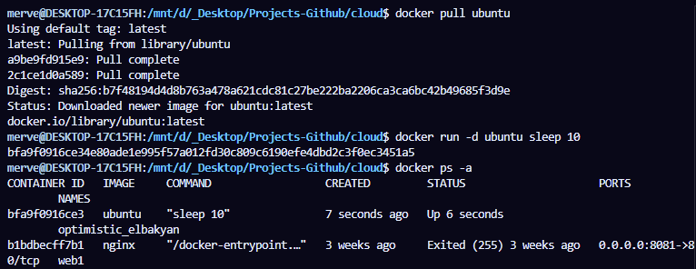
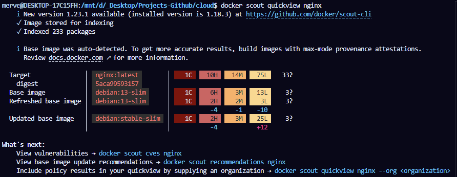
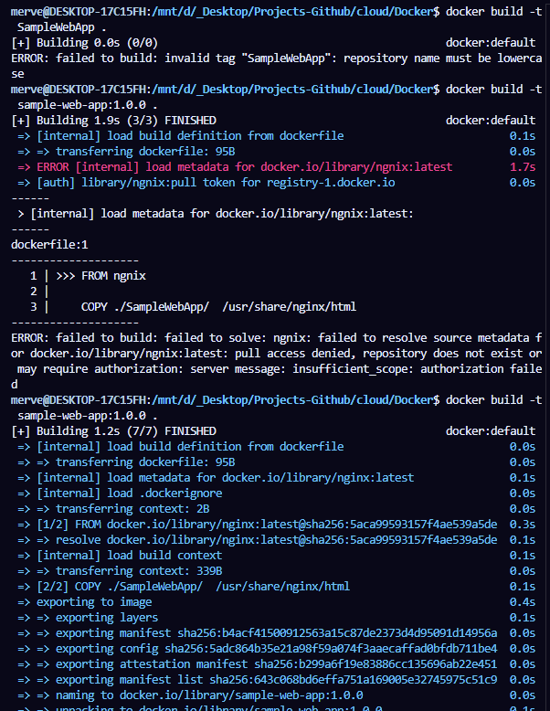

# Step #01

### Go to [https://hub.docker.com/repositories](https://hub.docker.com/repositories)


---

### Then search for the “Hello World” image


> I am using WSL because it makes it easier for me to switch between commands. You can also use the normal terminal without any issues.

---

### Commands

```bash
docker --version
docker images
docker pull hello-world
```


---

### Docker Desktop App


---

### Run a container


```bash
docker run <image-name>
```

---

### To remove a container, use:

```bash
docker rm <container-id>
```

---

### To remove a Docker image:

```bash
docker rmi <image-name or image-id>
```

---


---

```
docker pull mrc.microsoft.com/dotnet/sdk
docker images
```


### Delete image with 
```
docker rmi <image-id> 
#or 
docker rmi <image-id> -f
```


## Ubuntu Container 
### Commands
```
docker pull ubuntu
#or
docker run -d ubuntu sleep 10 
docker ps -a
``` 


## nginx Image 
### Commands
```
docker scout quickview nginx
```



## Dockerfile

repo name must be lowercase 
ensure the syntax in the dockerfile is correct 